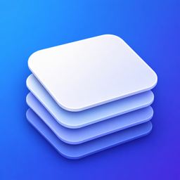
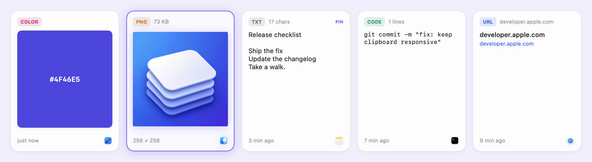
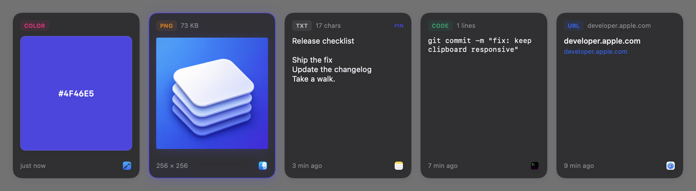

<p align="center">
  
</p>

<h1 align="center">Clipa</h1>

<p align="center">
  <strong>Everything you copy. One shortcut away.</strong><br>
  A native clipboard manager for macOS, with a little more in reach.
</p>

<p align="center">
  <a href="https://apps.apple.com/app/id6785361561?mt=12"></a>
</p>

<p align="center">
  
  
  <a href="LICENSE"></a>
  <br><br>
  English · <a href="README.zh-CN.md">简体中文</a>
</p>



Copy something once. Find it when you need it again. Press **⌘⇧V** to bring up
your clipboard history, search for an item, and copy it back. Paste with **⌘V** in
your destination app.

Clipa keeps clipboard history on your Mac and brings useful everyday tools into
the same menu bar app: collections, color picking, screenshots, and archives.
The current Release build is **free, with all features available**.

## What you can do

| Keep your work close | Finish the small things |
| --- | --- |
| **Clipboard history** — text, rich text, links, code, images, and files | **Color picking** — grab a color from your screen |
| **Instant search** — find a previous copy without leaving the keyboard | **Screenshots** — capture what you need from the menu bar |
| **Pins & collections** — keep snippets you come back to | **Archives** — compress files and extract supported archives |
| **History controls** — exclude apps, choose retention, and clear items | **Native macOS** — menu bar access, launch at login, light and dark appearance |

<details>
<summary>See the dark appearance</summary>



</details>

## Get Clipa

**For everyday use:** [Download Clipa from the Mac App Store](https://apps.apple.com/app/id6785361561?mt=12).
The App Store is the official distribution channel. You do not need Xcode to use
that version.

**For developers:** build the source below. This repository does not require an
account, a private backend, or the maintainer's signing certificates.

## Build from source

Requires **Xcode 26 or later**, with its command-line tools selected. Clipa runs
on **macOS 14 or later**. Dependencies are resolved by Swift Package Manager and
pinned in `Package.resolved`.

```sh
git clone https://github.com/HansenCCC/Clipa.git
cd Clipa
xcodebuild -project Clipa.xcodeproj -scheme Clipa \
  -configuration Release -derivedDataPath build \
  -disableAutomaticPackageResolution build
open build/Build/Products/Release/Clipa.app
```

The project uses **ad-hoc signing** for local builds. No Apple Developer team or
distribution certificate is configured. You can also open `Clipa.xcodeproj` in
Xcode and run the Clipa scheme. Use a Release build for the free, all-features
behavior; Debug retains development controls for the historical StoreKit flow.

The checked-in project is ready to build. To regenerate it after adding source
files, install the Ruby dependency with `bundle install`, then run
`bundle exec ruby gen_project.rb`. The generator preserves the package lockfile.

## Privacy

- Clipboard content is stored locally using SwiftData. It is not sent to a cloud
  clipboard service.
- Recognized sensitive clipboard types are skipped. This is a useful filter,
  not a guarantee that all secrets can be detected; use app exclusions and clear
  history when needed.
- Source builds **do not send startup statistics by default**. The optional
  endpoint is empty. A distributor can explicitly configure it using
  `CLIPA_STARTUP_STATS_URL`; the request contains the platform, app version, and
  build number, not clipboard content.
- Opening web links, App Store actions, and optional configured statistics may
  use the network. The distributed App Store build has its own
  [privacy policy](https://chenghengsheng.top/app/6785361561/privacy.html).

Clipa uses manual paste, so its normal clipboard workflow does not ask for
Accessibility permission. macOS may request permission when using screen capture
or other system features.

## Development & contributions

Clipa is built with **SwiftUI, AppKit, SwiftData, and StoreKit 2**. Focused fixes,
translations, documentation, and reproducible bug reports are welcome.

```sh
zsh tests/run_clipboard_monitor_harness.sh
zsh tests/run_panel_controller_harness.sh
```

Read [CONTRIBUTING.md](CONTRIBUTING.md) before sending a pull request. Please use
synthetic examples in issues and screenshots: clipboard history can contain
private information. For security reports, see [SECURITY.md](SECURITY.md).

The images above are rendered from Clipa's native card views with demonstration
data. They do not contain a real user's clipboard history.

## License & acknowledgements

Clipa's own code is available under the [MIT License](LICENSE).
Third-party dependencies retain their own terms, including the bundled UnRAR
code's separate license. See [Third-party notices](THIRD_PARTY_NOTICES.md) for
the pinned versions and preserved license texts.

Made by [Hansen](https://github.com/HansenCCC).
